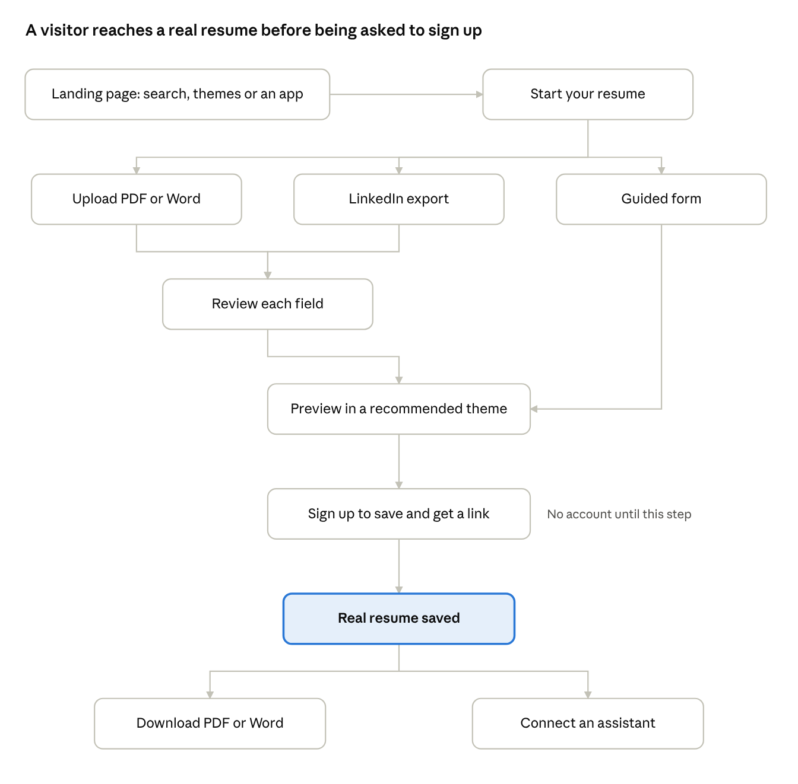
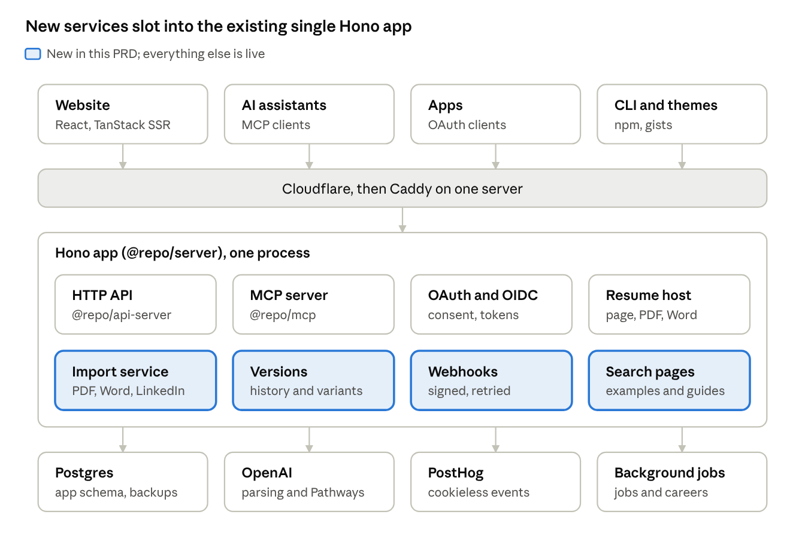
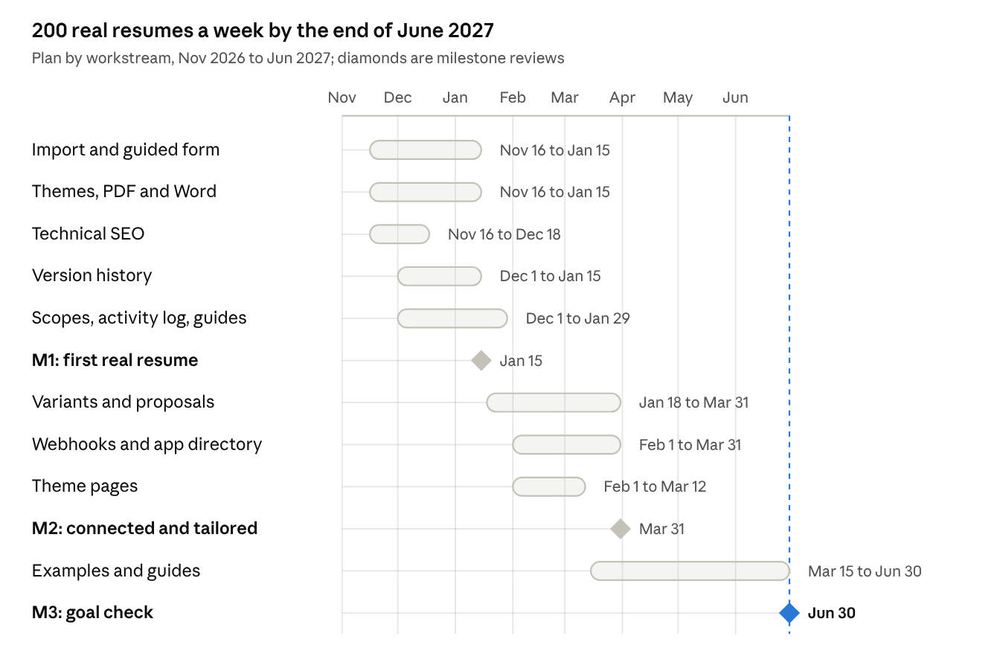

# JSON Resume PRD: Resume Data for the AI Era

7 November 2026 · Thomas Davis · Living copy: [Claude Doc](https://claude.ai/artifact/LmQMn1ZyA4WmmdANmXZjZQ) (comments and edits happen there; this file is a snapshot)

## Summary

JSON Resume should stop competing with resume builders on their terms and become the place your resume lives as data: the one record that people, apps and AI agents all read and write. Over the next two quarters we ship three things that make that true for people who will never open a JSON file.

- **Import first.** A new visitor drops in a PDF, Word file or LinkedIn export and has a real, themed resume in under five minutes, without seeing JSON.
- **Agent native.** Any AI assistant can connect in one step (MCP and OAuth) to read, tailor and save the resume, and every tailored version is kept and traceable.
- **Found by search.** Theme, job title and example pages bring in job seekers who search for “software engineer resume example”, not “json resume”.

The developer standard (schema, CLI, themes, registry) stays free and open, and is the moat: every tool that adopts the format feeds people back to jsonresume.org.

**The north-star metric is weekly real resumes saved**: an account saves a resume built on jsonresume.org (not imported from an existing gist) that is not the sample and has at least one job and one skill. In the two weeks since the new site launched that was 8 resumes, about 4 a week; the target is 200 a week by the end of Q2 2027.

**Not in scope:** paywalls, cover-letter generators, a job-application autopilot, or out-spending resume.io on ads.

## Problem and context

JSON Resume is a successful standard and an unsuccessful product: developers adopted the format, but almost nobody new builds a resume on jsonresume.org.

### Why resume.io wins its market

Resume.io and its peers are businesses built to turn job seekers into paying customers. Their advantages come from that model, not from better technology.

| Factor             | Resume.io (approximate, from public behaviour)                   | JSON Resume today                                      |
| ------------------ | ---------------------------------------------------------------- | ------------------------------------------------------ |
| Audience           | Any job seeker, usually non-technical                            | Developers comfortable with JSON, gists and CLIs       |
| First five minutes | Pick a template, fill a form, see a polished page                | Sign up, then face a sample resume or a JSON editor    |
| Revenue            | Free to build, pay to download, via a trial that renews          | None; donations and the maintainer's time              |
| Acquisition        | Paid search, thousands of “resume example” pages, many languages | Word of mouth, GitHub, search for “json resume”        |
| Focus              | One job: a good resume and cover letter, fast                    | Schema, CLI, registry, 227 themes, jobs, Pathways, MCP |
| Design quality     | In-house designers, a small curated set                          | Community themes of uneven quality, now curated        |

We cannot match the ad budget, and should not copy the paywall. We can win where resume.io cannot follow: open data that any tool or AI agent can use.

### What our own data shows

- **The new site's sign-ups are mostly existing users moving over.** Of 91 accounts created since 24 Oct, 78 pull their resume from an existing GitHub gist and 72 signed in with GitHub.
- **New people rarely finish.** Only 20 accounts store a resume on the site, and only 8 of those are real (not the sample, at least one job and skill).
- **Traffic is mostly machines.** In the last 30 days, `.json` downloads (12,638 from 12,009 visitors) outnumbered page views (8,113). Most downloaders are HR sourcing tools, scripts and crawlers.
- **Search barely reaches us.** In the first PostHog data, Google sent 26 visitors in two weeks, against 122 direct.
- **People who arrive look at themes.** /themes is the second most visited page after the home page.
- **Onboarding breaks at the handoffs.** One recent sign-up came through an OAuth app, lost their place between sign-in and sign-up, and saved only the sample. One AI-assistant connection failed because the localhost callback never arrived. Both are fixed, but they show how fragile the first run is.

## Goals, non-goals and metrics

Success by the end of Q2 2027 is 200 real resumes built on the site each week, with a quarter of active resumes connected to at least one app or agent.

### Goals

1. **Anyone can get a good resume here without JSON.** Import or a guided form, then a polished theme, PDF and Word file.
2. **The resume is the user's data, usable everywhere.** One record that assistants, apps and the CLI read and write, with every change traceable.
3. **Job seekers find us through search.** Pages that answer real queries bring traffic that does not depend on developers.
4. **The open standard stays healthy.** Schema, themes and CLI keep improving, and apps that adopt them are easy to build and list.

### Non-goals

- Charging for downloads or locking features behind a subscription.
- Auto-applying to jobs on the user's behalf.
- A cover-letter or LinkedIn-post generator as a headline feature.
- Paid acquisition at a scale we cannot fund.
- Rewriting the schema; proposals keep their existing process.

### Metrics

| Metric                                     | Definition                                                                                       | Baseline (Nov 2026)                   | Target, end Q2 2027 |
| ------------------------------------------ | ------------------------------------------------------------------------------------------------ | ------------------------------------- | ------------------- |
| **Weekly real resumes built (north star)** | Accounts whose first save of a stored resume is real: not the sample, at least 1 job and 1 skill | ~4 a week                             | 200 a week          |
| Sign-up to real resume                     | Share of new accounts with a real resume within 24 hours                                         | 8 of 20 stored-resume accounts (40%)  | 60%                 |
| Time to first real resume                  | Median minutes from sign-up to the first real save                                               | Not measured                          | Under 5 minutes     |
| Connected resumes                          | Share of weekly active resumes with an OAuth grant or API key used in the last 30 days           | 11 of 91 accounts have granted an app | 25%                 |
| Organic search visitors                    | Weekly visitors referred by search engines, excluding bots                                       | ~13 a week                            | 2,000 a week        |
| Download quality                           | Share of PDF and Word downloads that pass the ATS check without errors                           | Not measured                          | 95%                 |
| 30-day return                              | Share of accounts that come back to edit, tailor or export within 30 days                        | Not measured                          | 35%                 |

Guardrails: no growth in bot-driven views counted as people, page weight under 200 KB on the resume page, and no regression in the schema's backward compatibility.

## Users and jobs to be done

We design first for the job seeker who will never see JSON, because that is where growth is, and make sure nothing we build for them takes anything away from developers and agents.

| Who                                  | What they are trying to do                                                          | What they need from us                                                   | Today                                                 |
| ------------------------------------ | ----------------------------------------------------------------------------------- | ------------------------------------------------------------------------ | ----------------------------------------------------- |
| **Job seeker** (primary)             | Get a resume that looks professional and passes applicant-tracking systems, tonight | Import an old resume, pick a look, fix gaps, download PDF and Word       | Lands on the sample or a JSON editor; often leaves    |
| **Active candidate**                 | Tailor the resume for each application without losing the master copy               | Versions per job, an assistant that edits safely, a diff of what changed | One resume per account; no versions                   |
| **Developer**                        | Keep the resume in git or a gist, render it in many themes, script it               | Schema, CLI, gist sync, themes on npm, a stable public URL               | Well served; the original audience                    |
| **AI assistant** (acting for a user) | Read and change the user's resume on request, with permission                       | MCP tools, OAuth, clear errors, a sandbox for drafts                     | MCP server and OAuth live; 46 tool calls in two weeks |
| **Tool builder**                     | Build an app on top of the format: ATS, job boards, portfolio sites, editors        | Docs, OAuth apps, webhooks, a directory listing, the badge               | OAuth apps and badge live; no webhooks                |
| **Recruiter or HR tool**             | Read public resumes in a structured form                                            | Stable `.json` URLs, clear terms, rate limits                            | Heavy, unmanaged use of `.json` downloads             |

The job seeker's job is the one to win: the other groups already have what they need, and every new job seeker who stores a resume here becomes reachable by the agents and apps built on the format.

## Positioning and strategy

**Positioning:** _Your resume as data. Write it once, look good anywhere, and let any app or AI assistant use it with your permission._

Resume builders own the document. We own the record behind it. That record matters more each year, because assistants now draft applications, tailor resumes and match jobs, and they all need structured data they are allowed to change.

### Two tracks, one loop

- **Track A, the mainstream path.** Import first, curated themes, excellent PDF and Word, and search pages. This brings job seekers who never see JSON.
- **Track B, the platform.** MCP, OAuth apps, versions, webhooks and the open standard. This makes a resume stored here more useful than one stored anywhere else.

The tracks feed each other. More stored resumes make the platform worth building on. More apps and assistants built on it give people reasons to keep their resume here, and every app that shows the “Works with JSON Resume” badge sends people back.

### Principles

1. **Never show JSON unless asked.** It is one click away for developers, never the default.
2. **Free and open by default.** Every feature works without payment. If money is ever needed, it comes from optional extras for teams or apps, not from holding a resume hostage.
3. **Every feature is an API and an MCP tool.** The site is one client of the platform, not a special case.
4. **The user owns the record.** Export everything, delete everything, and see which apps changed what.
5. **Measure people, not machines.** Bot traffic never counts toward a goal.

## Requirements

Requirements are grouped into six pillars. P0 ships in the first milestone and blocks the north-star goal; P1 follows in the next quarter; P2 is planned but can move.

### 1. Import-first onboarding

A new visitor gets from nothing to a real resume in under five minutes, and never sees the sample saved as theirs.

| ID    | Requirement                                                                                                          | Priority | Acceptance criteria                                                                                    |
| ----- | -------------------------------------------------------------------------------------------------------------------- | -------- | ------------------------------------------------------------------------------------------------------ |
| IMP-1 | Import a PDF or Word resume: parse it into the schema, then show a review screen with each field and how sure we are | P0       | On a test set of 50 real resumes, 90% of fields land in the right place; import takes under 30 seconds |
| IMP-2 | Import a LinkedIn data export (zip) or LinkedIn profile PDF                                                          | P0       | Work, education and skills come through for 9 of 10 test exports                                       |
| IMP-3 | Start from scratch with a guided form: one section at a time, examples for each field, no JSON on screen             | P0       | A first-time tester finishes a one-job resume in under 5 minutes                                       |
| IMP-4 | Never store the sample as a user's resume; the sample is a preview only                                              | P0       | No account's first save is the sample; `resume_saved` carries `real: true` or `false`                  |
| IMP-5 | Paste plain text from anywhere and import it                                                                         | P1       | Same accuracy bar as IMP-1 on pasted text                                                              |
| IMP-6 | Keep the user's place (`next`, the app asking for access) through every sign-in, sign-up and username step           | P0       | An end-to-end test covers OAuth app to sign-up to consent to app, for GitHub and password              |

### 2. Output quality

What people download must look as good as resume.io's and pass applicant-tracking systems.

| ID    | Requirement                                                                                                 | Priority | Acceptance criteria                                                                              |
| ----- | ----------------------------------------------------------------------------------------------------------- | -------- | ------------------------------------------------------------------------------------------------ |
| OUT-1 | A recommended set of about 12 themes, each ATS-safe and print-tested, shown first in the editor and gallery | P0       | Every recommended theme passes the ATS check and prints on A4 and Letter without clipped content |
| OUT-2 | PDF matches the page, with a fit-to-one-page option                                                         | P0       | Visual regression tests on the recommended set; PDF made in under 5 seconds at p95               |
| OUT-3 | Word download that opens cleanly in Word, Google Docs and LibreOffice                                       | P0       | Checked by hand in all three for the recommended themes' content                                 |
| OUT-4 | ATS check shown in the editor, with one-click fixes                                                         | P1       | Each warning links to the field it is about                                                      |
| OUT-5 | Use this theme in one click from the gallery preview when signed in                                         | P1       | Theme changes and the page updates without visiting the editor                                   |

### 3. Tailoring and versions

People keep one master resume and safe, traceable copies for each application.

| ID    | Requirement                                                                                                       | Priority | Acceptance criteria                                                          |
| ----- | ----------------------------------------------------------------------------------------------------------------- | -------- | ---------------------------------------------------------------------------- |
| VER-1 | Every save is a version with who made it (the user, an app, an assistant) and a diff; any version can be restored | P0       | Restoring a version from 30 days ago gives back the exact JSON               |
| VER-2 | Variants: a named copy for a job, with its own link and theme, that the master never overwrites                   | P1       | A variant can be created from a job on /jobs or by MCP                       |
| VER-3 | Changes from apps can arrive as proposals the user accepts or rejects                                             | P1       | An MCP write with `propose: true` shows in the editor as a reviewable change |

### 4. Agent and app platform

Any assistant or app can be connected in one step, with clear permissions and a record of what it did.

| ID    | Requirement                                                                                               | Priority | Acceptance criteria                                                    |
| ----- | --------------------------------------------------------------------------------------------------------- | -------- | ---------------------------------------------------------------------- |
| PLT-1 | Connect guides for Claude, ChatGPT, Cursor and Gemini, each tested end to end every month                 | P0       | A scheduled check connects each client and calls `get_resume`          |
| PLT-2 | Scoped permissions (read, write, versions) on the consent screen, and an activity log per app in settings | P0       | Users can see and revoke each app's access and every change it made    |
| PLT-3 | Webhooks: apps are told when a resume they can read changes                                               | P1       | Signed deliveries with retries for 24 hours                            |
| PLT-4 | An apps directory, built from OAuth apps that opt in, with the badge                                      | P1       | Listed apps link to their site and show their scopes                   |
| PLT-5 | Terms, rate limits and keys for bulk readers of public `.json` resumes                                    | P2       | Unkeyed readers are limited; keyed readers are identified in analytics |

### 5. Search acquisition

Job seekers who search for resume help find useful pages here.

| ID    | Requirement                                                                                                    | Priority | Acceptance criteria                                                |
| ----- | -------------------------------------------------------------------------------------------------------------- | -------- | ------------------------------------------------------------------ |
| SEO-1 | Technical SEO: sitemap, canonical links, structured data and fast pages                                        | P0       | All public pages in the sitemap; Core Web Vitals pass on mobile    |
| SEO-2 | A page per theme (/themes/slug) with its preview, description and how to use it                                | P1       | 227 indexable pages, each with unique text                         |
| SEO-3 | Example resumes by job title (/examples/software-engineer), written or from public resumes whose owners opt in | P1       | 50 titles at launch, each with a one-click start from that example |
| SEO-4 | Short practical guides for writing each section and for common roles                                           | P1       | 20 guides, each linking to a starting point                        |
| SEO-5 | Pages in the five most requested languages                                                                     | P2       | Chosen from search data after SEO-3 ships                          |

### 6. Standard, ecosystem and trust

The format keeps improving and the numbers we steer by are honest.

| ID    | Requirement                                                                          | Priority | Acceptance criteria                                                           |
| ----- | ------------------------------------------------------------------------------------ | -------- | ----------------------------------------------------------------------------- |
| STD-1 | Publish the 150 new themes to npm (the open Version Packages release)                | P1       | Each theme installs and renders with the CLI                                  |
| STD-2 | Decide the open schema proposals on a fixed schedule                                 | P2       | Each proposal gets an accept, change or decline with reasons                  |
| STD-3 | `resume import` in the CLI, using the same import service                            | P2       | The CLI imports a PDF into resume.json                                        |
| TRU-1 | Bots excluded from every product metric and dashboard                                | P0       | Known crawlers, sourcing tools and forged-referrer traffic filtered at source |
| TRU-2 | Hide fields on the public page (phone, email, address) while keeping them in exports | P1       | Hidden fields never appear in the page, `.json` or search index               |

## Key user flows

The first run asks for an account only after the visitor has seen their own resume in a good theme, because that is the moment the account is worth having.

### Import-first onboarding

Imports go through a review screen; the guided form skips it. The draft lives in the browser until sign-up, then becomes the account's first version.

### Connecting an assistant

1. The user picks their assistant on /mcp and copies one command or URL.
2. The assistant opens jsonresume.org’s consent screen, which lists the scopes it asks for.
3. Signed-out users sign in or sign up without losing the request (IMP-6).
4. On Allow, the assistant gets a token; if its callback is on another machine, the finish page shows a command to complete it.
5. Every change the assistant makes is a version labelled with its name, visible in settings.

### From theme to download

1. The visitor browses the gallery and opens a preview.
2. Signed in, “Use this theme” applies it at once; signed out, it starts onboarding with that theme chosen.
3. The page updates; PDF and Word downloads use the same theme.
4. The ATS check runs on download and links any warning to the field to fix.

## Technical architecture

Nothing here needs a new server: the four new services are packages in the existing monorepo, mounted in the same Hono app, using the same Postgres and Effect style.

### New packages

| Package                 | Holds                                                                                                                           | Exposed as                                                                                         |
| ----------------------- | ------------------------------------------------------------------------------------------------------------------------------- | -------------------------------------------------------------------------------------------------- |
| `@repo/resume-import`   | File to text (PDF, Word, LinkedIn zip), a model call that returns schema-valid JSON, per-field confidence, a cache by file hash | `POST /api/import`, MCP `import_resume`, CLI `resume import`                                       |
| `@repo/resume-versions` | Append-only versions with actor, diff and restore; named variants; proposals                                                    | `/api/resume/versions`, MCP `list_versions`, `restore_version`, `create_variant`, `propose_change` |
| `@repo/webhooks`        | Subscriptions per OAuth app, signed deliveries, a retry queue in Postgres                                                       | OAuth app settings, MCP `list_webhooks`                                                            |
| `@repo/seo-pages`       | Theme, example and guide pages from `@repo/content`, the sitemap and structured data                                            | Prerendered routes in `apps/app`                                                                   |

### Data model changes

- `app.resume_versions` (id, profile_id, version, resume jsonb, actor_kind, actor_id, created_at, note): every save writes a row; `profiles.stored_resume` stays the latest copy for fast reads.
- `app.resume_variants` (id, profile_id, name, job_id, theme, resume jsonb): its own public URL, `/@username/variant-name`.
- `app.change_proposals` (id, profile_id, client_id, patch jsonb, state).
- `app.imports` (id, user_id, kind, file_hash, ms, fields, model, created_at): for quality and cost tracking; the file itself is not kept.
- `app.webhook_subscriptions` and `app.webhook_deliveries`.
- `oauth_clients` gains `scopes` and `listed`.

### Principles carried over

- Every feature is an Effect service with an `HttpApi` endpoint and MCP tools, tested with PGlite.
- Files stay under 200 lines; UI uses `@jsonresume/ui` and vanilla-extract.
- Imports never keep the uploaded file; only the parsed JSON the user confirms is saved.
- Migrations are additive, with a backup before each deploy that runs one.

## Instrumentation and analytics

Every goal metric comes from server-side events in PostHog, keyed by account id, with bots filtered before they count. PostHog stays cookieless; nothing here needs a consent banner.

### Events

| Event                                  | Sent when                                             | Key properties                                                                 | Status                              |
| -------------------------------------- | ----------------------------------------------------- | ------------------------------------------------------------------------------ | ----------------------------------- |
| `user_signed_up`                       | An account is created                                 | `method` (github, password), `via_app` (OAuth client id), `next`               | Live                                |
| `user_signed_in`                       | A session starts                                      | `method`                                                                       | Live                                |
| `resume_saved`                         | A resume is stored                                    | `real` (bool), `source` (editor, import, mcp, app), `sections`, `first` (bool) | Live; add `real`, `source`, `first` |
| `import_started` / `import_finished`   | An import begins and ends                             | `kind` (pdf, docx, linkedin, text), `ms`, `fields_found`, `fields_edited`      | New                                 |
| `theme_chosen`                         | The resume's theme changes                            | `theme`, `from` (gallery, editor, mcp)                                         | New                                 |
| `resume_downloaded`                    | A PDF or Word file is served to the owner or a person | `format`, `theme`, `ats_errors`                                                | New (today only in `resume_views`)  |
| `version_restored` / `variant_created` | VER-1 and VER-2 actions                               | `actor` (user, app, assistant)                                                 | New                                 |
| `mcp_tool_called`                      | An MCP tool runs                                      | `tool`, `client`, `ok`                                                         | Live                                |
| `oauth_granted`                        | A user approves an app                                | `client`, `scopes`                                                             | Live                                |
| `webhook_delivered`                    | A webhook is sent                                     | `client`, `ok`, `attempt`                                                      | New                                 |

### Funnels and dashboards

- **Activation funnel:** pageview → `user_signed_up` → `import_finished` or first editor save → `resume_saved` with `real` → `resume_downloaded` or `theme_chosen`. Broken down by method, `via_app` and import kind.
- **Platform health:** weekly active connected resumes, MCP calls by client and tool, error rate, OAuth grants and revokes.
- **Acquisition:** search visitors by landing page group (themes, examples, guides), and sign-ups each group drives.
- **Quality:** import accuracy (fields edited after import), PDF failures, ATS errors per download.

The primary PostHog dashboard (“jsonresume.org”) gains one tile per goal metric. Each tile keeps the existing test-account and bot filters.

## Milestones and rollout

Three milestones from mid-November to the end of June: M1 makes a real resume easy, M2 makes it connected and tailored, and M3 brings people in through search.

_Proposed plan; dates are targets, not commitments._

| Milestone                      | Scope                                                                                | Exit criteria                                                                       |
| ------------------------------ | ------------------------------------------------------------------------------------ | ----------------------------------------------------------------------------------- |
| **M1: first real resume**      | IMP-1 to IMP-4, IMP-6, OUT-1 to OUT-3, VER-1, PLT-1, PLT-2, SEO-1, TRU-1, new events | 50 real resumes built in one week; median time to first real resume under 5 minutes |
| **M2: connected and tailored** | VER-2, VER-3, PLT-3, PLT-4, OUT-4, OUT-5, IMP-5, STD-1                               | 15% of active resumes connected; first outside app using webhooks                   |
| **M3: goal check**             | SEO-2 to SEO-4, PLT-5, STD-2, STD-3; SEO-5 decided                                   | 200 real resumes a week; 2,000 search visitors a week                               |

### Rollout

- Each feature ships behind a flag to accounts created after launch, then to everyone after a week without regressions.
- Import launches on the home page and /themes first, then replaces the sample-first editor for all new accounts.
- Existing gist users keep their gist flow; versions start from their next save.
- Each milestone ends with a review of the goal tiles before the next one starts; if M1 misses its exit criteria, M2 waits and import quality gets the time.

## Risks, open questions and decisions

The biggest risk is that import quality is not good enough to replace the form, so it is measured from the first week and has a fallback.

| Risk                                               | Likelihood | Impact | Mitigation                                                                                           |
| -------------------------------------------------- | ---------- | ------ | ---------------------------------------------------------------------------------------------------- |
| Imports are wrong often enough that people give up | Medium     | High   | Review screen with confidence per field; measure fields edited after import; guided form as fallback |
| Model costs grow with imports and Pathways         | Medium     | Medium | Cache by file hash, cheaper model for parsing, a per-account daily cap                               |
| Search pages read as thin content and do not rank  | Medium     | High   | Fewer, better pages; real examples with owners' consent; measure before scaling                      |
| Assistants change resumes badly                    | Medium     | Medium | Versions on every save, proposals for app writes, activity log and one-click restore                 |
| Personal data in public resumes is scraped         | High       | Medium | Field hiding (TRU-2), rate limits and terms for `.json` (PLT-5)                                      |
| A single maintainer cannot carry two tracks        | High       | High   | P0 only in M1; Track B mostly reuses what exists; agents do most of the build                        |

### Decisions needed

- [ ] Is the north star “real resumes built on the site”, or should resumes imported from gists count too?
- [ ] Which model and provider parses imports, and what monthly spend is acceptable?
- [ ] Do example pages use real public resumes (with opt-in) or written examples only?
- [ ] Do we publish the 150 new themes to npm now (merge the open Version Packages release)?
- [ ] Is any paid tier ever on the table (for example, for apps with heavy API use), or is the project free forever?
- [ ] Which languages, if any, come after English?

## Appendix: current product and baseline

Most of the platform track already exists; the gaps are import, versions, webhooks and search pages.

### What exists today

| Area             | What is live                                                                                    | Gap this PRD closes                                    |
| ---------------- | ----------------------------------------------------------------------------------------------- | ------------------------------------------------------ |
| Accounts         | Email and GitHub sign-in, usernames, /@username pages, gist or stored resume                    | Import-first first run                                 |
| Editor           | Form and JSON editing, live preview, theme picker                                               | Guided form, versions, variants                        |
| Themes           | 227 themes, gallery with live preview modal and how-to-use                                      | Recommended set, one-click use, theme pages for search |
| Formats          | Page, PDF, Word, JSON, YAML, text, RenderCV, QR                                                 | Print and Word quality checks                          |
| ATS              | ATS check (site and MCP)                                                                        | Inline fixes in the editor                             |
| Agents           | MCP server with resume, theme, job, career and app tools; OAuth 2.1 and OIDC provider; API keys | Scopes, activity log, proposals, client guides         |
| Apps             | OAuth apps, “Works with JSON Resume” badge, apps section on /developers                         | Webhooks, opt-in directory                             |
| Jobs and careers | Hacker News jobs, matching, Pathways career graph and plans                                     | Tailored variants from a job                           |
| Analytics        | Cookieless PostHog, resume view counts, bot filters, dashboard                                  | Activation events and goal tiles                       |
| Standard         | Schema, CLI, registry copy, Explore                                                             | Theme npm release, proposal decisions, CLI import      |

### Baseline numbers

From the production database (read-only) and PostHog, as of 7 Nov 2026. The new site launched on 24 Oct 2026.

| Measure                                        | Value                                                   |
| ---------------------------------------------- | ------------------------------------------------------- |
| Accounts created since launch                  | 91 (10, 46 and 35 in the three weeks so far)            |
| Accounts signing in with GitHub                | 72 of 91                                                |
| Accounts using a gist as their resume          | 78 of 98 account profiles                               |
| Accounts storing a resume on the site          | 20, of which 8 are real                                 |
| Ghost profiles mirrored from gists             | 3,499                                                   |
| Public resumes behind theme usage counts       | 4,604                                                   |
| Resume page views, last 30 days                | 8,113 (about 580 a day over the last 14)                |
| `.json` downloads, last 30 days                | 12,638 from 12,009 visitors                             |
| Word downloads, last 30 days                   | 1 (launched 6 Nov)                                      |
| OAuth apps / tokens / users who granted access | 28 / 37 / 11                                            |
| API keys                                       | 13                                                      |
| MCP tool calls, PostHog's first two weeks      | 46, from 4 people                                       |
| Pathway plans                                  | 0                                                       |
| Top referrers, PostHog's first two weeks       | Direct 122, Google 26, GitHub 14, DuckDuckGo 7 visitors |
